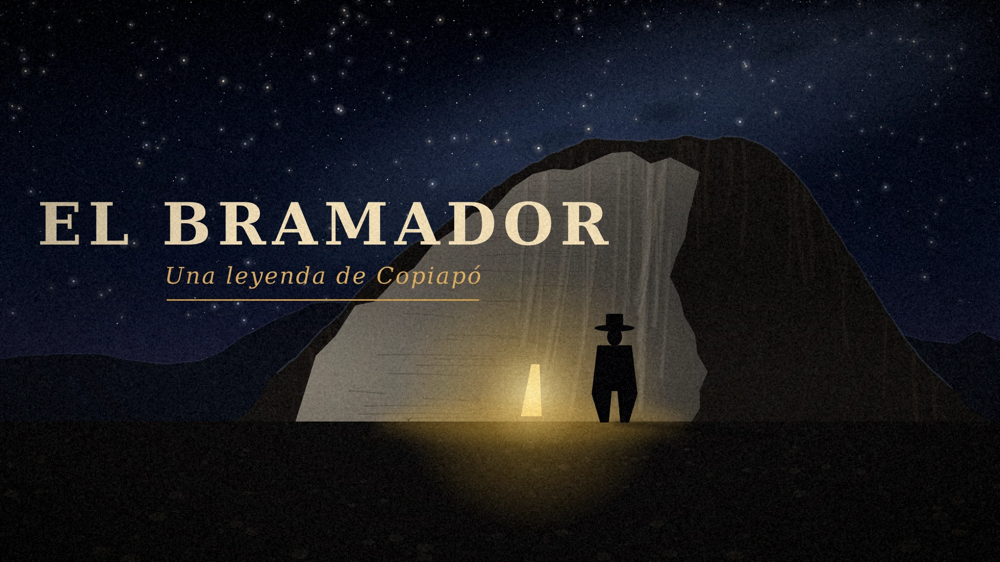

<div align="center">



# El Bramador

### Una leyenda de Copiapó

*Novela visual en español para Ren'Py · 4 finales · 25–35 minutos*


</div>

---

> *"Donde la arena no canta, ahí está la puerta."*

**Copiapó, invierno de 1839**, en plena fiebre de la plata. Matías Ardiles, cateador arruinado, recibe de su viejo amigo Celestino un derrotero que lleva al **Cerro Bramador**. Don Fermín Cisternas, el habilitador que se hizo rico de la noche a la mañana hace diez años, les financia la expedición... con una condición.

## Contenido

- [Personajes](#personajes)
- [Cómo jugar](#cómo-jugar)
- [Publicar en la web](#publicar-en-la-web)
- [Los cuatro finales](#los-cuatro-finales)
- [El bramido](#el-bramido)
- [Estructura del proyecto](#estructura-del-proyecto)
- [Herramientas](#herramientas)
- [Solución de problemas](#solución-de-problemas)
- [Sobre la ambientación](#sobre-la-ambientación)
- [Licencia y créditos](#licencia-y-créditos)

## Personajes

| Personaje | Quién es |
|---|---|
| **Matías Ardiles** | Narrador. Cateador arruinado. |
| **Rosario** | Su mujer. |
| **Celestino Aracena** | Viejo amigo de Matías; trae el derrotero. |
| **Don Fermín Cisternas** | Habilitador, rico de la noche a la mañana. |
| **Doña Tránsito** | Curandera. |
| **El Loco Ulises** | El loco del pueblo. |
| **El forastero** | Muy bien vestido. Aparece de noche junto a la fogata. |

## Cómo jugar

Necesitas el [SDK de Ren'Py 8](https://www.renpy.org/latest.html) (gratuito, para Windows, macOS y Linux).

**1. Descarga el proyecto**

```bash
git clone https://github.com/Club-Informatico/NG-El-Bramador.git
```

O usa **Code → Download ZIP** en GitHub y descomprímelo.

**2. Ábrelo en Ren'Py**

El repositorio ya es un proyecto completo de Ren'Py, así que no hay que copiar archivos:

1. Abre el launcher de Ren'Py.
2. En **Preferencias → Directorio de proyectos**, elige la carpeta que *contiene* `NG-El-Bramador` (o mueve `NG-El-Bramador` a tu carpeta de proyectos actual).
3. Haz clic en **Actualizar** y selecciona **NG-El-Bramador** en la lista.
4. Opcional: **Revisar script (Lint)**.
5. **Lanzar proyecto**.

> [!TIP]
> Si en vez de eso quieres copiar la carpeta `game/` dentro de otro proyecto de Ren'Py en macOS, no la arrastres encima de la otra con el Finder: el Finder **reemplaza** la carpeta entera en vez de combinarlas. Mantén presionada la tecla **Opción (⌥)** al arrastrar y elige **Combinar**, o usa la Terminal:
> ```bash
> ditto ~/Downloads/NG-El-Bramador/game ~/RUTA/A/TU/PROYECTO/game
> ```

## Publicar en la web

En el launcher, ve a la sección **Web → Construir aplicación web** y sube el resultado a [itch.io](https://itch.io) como un proyecto HTML.

El archivo [`progressive_download.txt`](progressive_download.txt) hace que imágenes y música se descarguen a medida que se necesitan, así el juego empieza a cargar más rápido en el navegador.

## Los cuatro finales

| | Final | Cómo se llega |
|---|---|---|
| I | **El precio** | Entregar a alguien |
| II | **El loco del Bramador** | Llevarse el oro sin pagar |
| III | **Arena** | Negarse al trato |
| IV | **La letra del trato** | El final verdadero; requiere pistas |

El juego recuerda los finales que ya viste y, al terminar, te da una pista para llegar al que falta.

<details>
<summary><b>Spoiler: cómo llegar al final IV</b></summary>

Lee el contrato y pide copia, escucha a Ulises o visita a doña Tránsito, y no le aceptes nada al forastero.

</details>

## El bramido

El sonido del cerro es una **recreación original**, sintetizada a partir del análisis de una grabación real del Cerro Bramador: una nota grave de ~68–88 Hz (el cerro "canta" cerca de un Re grave) con sus armónicos, ataque lento como de avalancha y temblor de amplitud.

Al empezar cada partida el juego pregunta cómo quieres escucharlo:

- **Bramido completo**: como suena el cerro de verdad.
- **Bramido suave** (recomendado con audífonos): quita la nota más grave (~70 Hz). El oído sigue reconociendo el mismo tono gracias a los armónicos, pero con mucha menos vibración y a menor volumen.

Puedes cambiar de modo en cualquier momento con la tecla **B**.

Al entrar al cerro suena un bramido de 30 segundos que imita la forma de la grabación real: arranca lento, se sostiene cerca de 70 Hz y al final sube a ~87 Hz antes de apagarse. Sigue sonando aunque avances el texto.

| Archivo | Uso |
|---|---|
| `audio/bramido.ogg` | Cercano |
| `audio/bramido_lejano.ogg` | A la distancia |
| `audio/bramido_furioso.ogg` | El cerro enojado |
| `audio/bramido_entrada.ogg` | La entrada al cerro (30 s) |
| `audio/bramido_coro.ogg` | Adentro: el coro de las almas (sin graves) |

Los cuatro primeros tienen además una versión `_suave`.

> [!NOTE]
> La grabación original que se usó como referencia **no viene incluida**. Si quieres usarla, reemplaza `audio/bramido_entrada.ogg` por ese archivo (en `.ogg`) y, si vas a publicar el juego, pide permiso a su autora o al menos dale crédito.

## Estructura del proyecto

```
NG-El-Bramador/
├── game/
│   ├── script.rpy                  Guion completo (prólogo, 4 capítulos, 4 finales)
│   ├── bramador_definiciones.rpy   Personajes, imágenes, transiciones y sonido
│   ├── options.rpy, gui.rpy, screens.rpy
│   ├── images/
│   │   ├── bg/                     14 fondos (.webp, 1920x1080)
│   │   ├── cg/                     5 escenas especiales (.webp)
│   │   ├── sprites/                14 sprites (.png transparente, 820x1080)
│   │   └── menu/                   Fondos del menú principal y de los menús
│   ├── audio/                      Música, bramidos (+ versiones suaves) y efectos
│   └── fonts/                      DejaVu Serif (con su licencia)
├── herramientas/                   Scripts que generaron el arte y el sonido
├── progressive_download.txt        Reglas de descarga progresiva para la versión web
└── LICENSE
```

## Herramientas

Todo el arte y el audio del juego se generó por código. Los scripts están en [`herramientas/`](herramientas/):

| Script | Qué hace | Requiere |
|---|---|---|
| `arte/fondos_b.py` | Fondos | Python 3, Pillow, NumPy, `rsvg-convert` |
| `arte/sprites_b.py` | Sprites de personajes | Python 3, Pillow, NumPy, `rsvg-convert` |
| `arte/cgs_b.py` | Escenas especiales | Python 3, Pillow, NumPy, `rsvg-convert` |
| `sonido/base.py` | Música y efectos | Python 3, NumPy, SciPy, `ffmpeg` |
| `sonido/audio_bramador.py` | Los bramidos | Python 3, NumPy, SciPy, `ffmpeg` |
| `validar_renpy.py` | Revisión rápida del guion (no reemplaza al Lint de Ren'Py) | Python 3 |

```bash
pip install pillow numpy scipy
python herramientas/validar_renpy.py game
```

Cada generador acepta nombres de recursos como argumentos (por ejemplo `python fondos_b.py cerro_noche`); sin argumentos los genera todos.

> [!WARNING]
> Las rutas de salida están fijas dentro de los scripts (`OUT` en `arte/lib.py` y `sonido/base.py`, y `GUI`/`TMP` en `arte/cgs_b.py`). Cámbialas por las de tu equipo antes de usarlos, o **sobrescribirán** los archivos del juego si apuntan a `game/`.

## Solución de problemas

- **El juego no arranca o se cierra:** Ren'Py deja `log.txt` (y `traceback.txt` si hubo un error) en la carpeta del proyecto, al lado de `game/`. Ahí aparece la causa.
- **El guion se rompió después de editarlo:** no uses TextEdit ni Word, que cambian las comillas por comillas tipográficas. Usa el editor que ofrece el launcher (Visual Studio Code) o cualquier editor de código.
- **Los cambios no aparecen:** cierra el juego antes de volver a lanzarlo desde el launcher.

## Sobre la ambientación

**Reales:** el Cerro Bramador (sector Toledo, al poniente de Copiapó) y su bramido, el descubrimiento de Chañarcillo en 1832 y la fiebre de la plata, y el naturalista inglés que en 1835 escuchó a los copiapinos hablar del "Bramador" (era Charles Darwin; en el juego no se le nombra).

**Inventados:** todos los personajes, la compañía "La Fortuna del Poniente" y, por supuesto, lo que hay adentro del cerro... o eso dicen.

## Licencia y créditos

- Código, guion y recursos: [GNU GPL v3](LICENSE).
- Tipografía: DejaVu Serif, licencia libre incluida en [`game/fonts/LICENCIA-DejaVu.txt`](game/fonts/LICENCIA-DejaVu.txt).
- Hecho con [Ren'Py](https://www.renpy.org).
